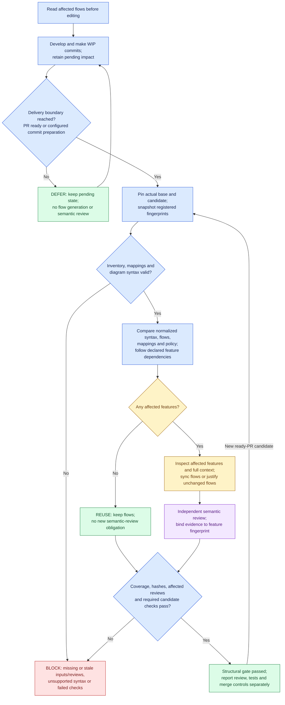

# Flow documentation synchronization

Keep system overview, feature flows and implementation references consistent in the change delivered for review and merge. The bundled checker verifies structural/content consistency; source review and behavioral evidence establish semantic confidence.

## Select the operation

- **Adopt:** inventory features/inputs, establish flows and mappings, install the project reading rule and checker/hook.
- **Maintain:** read affected flows before editing; synchronize and review at the configured delivery boundary without requiring a separate user invocation.
- **Audit:** report coverage gaps and bypasses without changing the system.

Read local instructions and terminology first; reuse the project's documentation and discovery tools. Installing this skill does not configure a project or its CI. Whole-project adoption requires all first-party behavior-bearing logic accounted for; excluded logic remains an explicit coverage gap.

## Project files and responsibilities

Use these repository-relative paths for new adoption. `<feature-id>` is the manifest feature ID, such as `download.run`; use filename-safe IDs. `<fingerprint>` is the checker's current feature fingerprint, and `<scenario-id>` is a stable filename-safe runtime scenario name.

| Path / filename | Required when | Purpose |
| --- | --- | --- |
| `AGENTS.md` | Every adoption | Shared pre-edit reading and delivery-boundary synchronization rules; record the trigger policy, actual paths and checker command. |
| `docs/flows/README.md` | Every adoption | System overview and flow index: feature IDs, links to checked flows and contracts, source-file/symbol navigation, adopted scope/gaps, and existing document paths/owners. |
| `docs/flows/<feature-id>.mmd` | Each adopted feature | Checked Mermaid flowchart for that feature. Set the manifest's `flow` to this exact path. An explicitly selected PlantUML flow uses the same basename with `.puml`. |
| `docs/flow-manifest.json` | Every adoption | Machine-readable source inventory, fingerprints, feature/node/symbol mappings, `depends_on`, reviews and policy inputs. |
| `docs/flows/contracts.md` | Shared contracts have no existing authoritative document | Shared boundaries, inputs/outputs, errors and invariants. If an existing contract owns them, link its exact path from the flow index instead of copying it. |
| `docs/flow-evidence/adoption.md` | Every adoption | Adoption report: exact artifact paths, reused documents, scope/gaps and separate verification states. It records results; rules remain in `AGENTS.md`. |
| `docs/flow-evidence/reviews/<feature-id>/<fingerprint>.json` | A feature requires independent review | Complete passing reviewer JSON; other attempts remain in task evidence. The corresponding manifest review entry's `evidence` points to this exact file. |
| `docs/flow-evidence/runtime/<feature-id>/<scenario-id>.md` | Runtime or external-behavior evidence is needed | Filled runtime evidence template. Keep supporting logs/traces/images beside it in `<scenario-id>/`, surviving environment cleanup. |
| `tools/flow-docs/flow_checker.py`, `tools/flow-docs/flow_parsers.py`, `tools/flow-docs/requirements-ast.txt` | Every checker-enabled adoption | Copy the complete bundled `scripts/` directory here: CLI checker, optional language adapters and dependency pins. |
| `.git/hooks/pre-commit` | Selecting strict per-commit validation without an existing hook manager | Staged check entrypoint. Compose with an existing hook manager or configured `core.hooksPath` instead, recording the actual file path. |
| `.github/workflows/flow-docs.yml` | Adding a dedicated GitHub Actions check | Project-specific trigger and candidate validation workflow; record any AI runner command and output paths. No workflow or AI runner is bundled; record the exact existing CI path when reused. |
| `README.md` at repository root | Optional navigation | Short introduction and link to `docs/flows/README.md`; it does not own synchronization rules, feature flows, the manifest or adoption evidence. |

Existing requirements/architecture/contracts keep their authoritative locations; the flow index references them. Reusing documents does not relocate these required artifacts. Only explicit project instructions may override the default layout: record every default-to-actual path in `AGENTS.md` and the actual flow index, and update commands, manifest/evidence pointers and links consistently. Root `README.md` cannot substitute for required artifacts.

## Mandatory bootstrap, available in this file

During adoption, keep the shared synchronization rule in root `AGENTS.md` as its single source of truth. Use the project-file layout above; resolve and record any explicitly required path overrides before writing this block. Preserve existing instructions and local-only files. Establish missing document baselines before enabling their pointers.

When the actual Claude Code session discovers `AGENTS.md` directly, do not create `CLAUDE.md`. If root `CLAUDE.md` already exists, preserve its content and add a missing `@AGENTS.md` import; `.claude/CLAUDE.md` uses `@../AGENTS.md`. Imports resolve relative to their containing file; an ordinary Markdown link does not load instructions. For sessions without direct support, use a minimal import entrypoint as a compatibility fallback. Keep the rule itself in `AGENTS.md`.

Preserve `CLAUDE.local.md`: it can switch default discovery away from `AGENTS.md`, as can relevant ancestor instruction files. Verify imports or the session's effective instruction-file setting, including nested scopes and other tools; report discovery unverified when it was not observed. See the [entrypoint matrix](references/enforcement-contract.md#agent-entrypoint-discovery) for version conditions and verification.

```markdown
## [MANDATORY] Flow Documentation Sync Gate
1. Pre-Edit Read: before adding, modifying, refactoring, moving or deleting
   code or behavior-bearing inputs, read docs/flows/README.md,
   docs/flow-manifest.json and all affected feature/shared flows and contracts.
   Before the first edit, report: Affected Feature IDs: <resolved IDs>.
   Read baseline flows together with the pending task diff during WIP.
   Missing or untrusted baselines require source verification first;
   unreadable required documents block dependent edits.
2. Delivery Sync: default to PR delivery. During edits, Draft PRs and WIP
   commits, retain pending impact without generating flows or review records.
   Before handing a non-draft PR to review, synchronize affected documents,
   mappings and fingerprints and obtain required independent agent review.
   Recheck every later candidate; regenerate/review only invalidated features.
   Use the recorded automation when configured; otherwise the preparing agent
   performs Maintain without waiting for a separate user command and reports
   missing automation. Required CI validates the actual merge candidate against
   a trusted comparison base. Never compare a committed candidate to itself.
   A project without PRs uses its recorded pre-commit preparation boundary.
   Preserve repository human approvals; hashes alone are not semantic review.
3. Delegation/resume: each executing agent reads its own affected documents.
   Recheck the read set after scope/input changes or a handoff.
   Missing required checks or unresolved coverage prevent completion claims.
```

This block is usable without a reference file or installed skill. For new capabilities, read related flows and record proposed behavior in task evidence before implementation; defer maintained flow generation to the delivery boundary. Record read document identities and affected IDs in existing task evidence. Reading source to discover impact is allowed before editing. A read declaration cannot prove comprehension.

If an optional packaged resource is missing, retain this rule, verify the installed package and recover the matching resource from the skill's managed source. Report tooling incomplete; missing tooling does not authorize bypassing it or require stopping unrelated work.

## Adopt workflow

1. **Assign document responsibility.** Inventory existing requirements, architecture, contracts and flows; record their real paths and owners in `docs/flows/README.md` using the layout above. Requirements/contracts define intended behavior; source review establishes actual behavior. Record conflicts before changing the owning document instead of duplicating it.
2. **Choose a bounded scope.** Start with a core end-to-end feature plus its shared dependencies and behavioral inputs. List excluded and unknown areas as coverage gaps; partial adoption cannot claim whole-project coverage. Follow the [adoption inventory](references/enforcement-contract.md#adoption-inventory-and-staged-rollout).
3. **Establish the baseline.** Select explicit source modes, register sources/symbols and feature dependencies, then create the overview, per-feature flows and manifest at their specified paths. Link existing authoritative documents and reuse source-discovery tools. Refresh registered fingerprints and obtain initial reviews against the real comparison base before claiming a passing baseline.
4. **Install and verify.** Adopt the inline bootstrap and check actual discovery/read-before-edit ordering. Record the [delivery trigger policy](references/enforcement-contract.md#delivery-triggers-and-generation) and actual runner/workflow paths in `AGENTS.md` and the flow index. Copy the checker tools. Install the strict hook only for an explicit per-commit policy; preserve existing hooks. Run candidate-specific checks and verify required CI/merge settings. Preserve project-specific validation; absent execution evidence remains unverified.
5. **Report each gate.** Write `docs/flow-evidence/adoption.md` using the [completion report](references/enforcement-contract.md#completion-report), listing every required/conditional artifact with its exact path and created/reused/missing/not-applicable status. Save runtime evidence at the specified per-feature scenario path using the [template](references/enforcement-contract.md#runtime-evidence-template). Expand the adopted scope with its dependencies through another reviewed change; retain the same gates within the adopted scope.

Before claiming adoption complete, verify each required artifact exists, has its assigned content and is linked correctly. For conditional artifacts, record the actual file or a concrete reason it is not applicable. A README-only change, an empty directory, or a checklist claiming files exist does not establish adoption; missing artifacts/checks leave it incomplete.

## Maintain workflow

Read affected documents before edits. Defer steps 2-6 until PR delivery: opening a non-draft PR, marking a Draft ready, or updating a ready PR. Draft/WIP work may remain pending and cannot claim synchronized delivery. On subsequent candidates, compare relevant fingerprints before invoking AI; reuse evidence only when all bound inputs still match. For projects without PRs, use preparation of the intended commit. See [delivery triggers and generation](references/enforcement-contract.md#delivery-triggers-and-generation) for automation, CI and staged-content boundaries.

Batch preparation after intended content settles. Use local impact checks and the preparing agent's existing context; preparation needs no separate model call. Keep unchanged flows and matching review evidence.

1. **Read and pin.** Read root instructions, overview, manifest, affected flows and shared contracts. Identify the comparison base and exact worktree, staged or committed candidate. Re-read after expanding scope.
2. **Compute impact.** Use the union of base/candidate mappings, including removed records, new files and new symbols in existing files. Follow explicit dependent-feature links. Review scope reductions and policy/checker changes separately. Uncertain dependencies use conservative file-level coverage.
3. **Synchronize.** Update flow sources, mappings and evidence. Run `snapshot` to refresh explicitly registered inputs; it does not register unknown code or approve behavior. Native Python and optional multi-language Tree-sitter adapters normalize syntax while retaining semantic tokens/directives. Module context changes affect all features mapped to that file; symbol-body changes affect mapped features and declared dependents. Keep raw MD5 for file-byte integrity. Unsupported syntax or uncertain dynamic dependencies use explicit file-level coverage rather than an invented symbol match.
4. **Review automatically.** Only for affected features lacking matching passing evidence: resolve local structural failures and run relevant behavioral tests before dispatch; missing current review evidence remains expected at this point. Obtain affected fingerprints after necessary synchronization. Follow [review preparation](references/reviewer-prompt.md#review-preparation), then dispatch a fresh reviewer with no author conversation history using the raw-artifact template. Save its structured result and add the matching manifest entry only for a complete passing review. Apply the reference's [separate correction and material-recovery limits](references/reviewer-prompt.md#correction-and-material-recovery). Missing review blocks synchronized delivery; finish unrelated safe work and report the gate. Agent review does not replace repository human approval.
5. **Check.** Run the bundled checker on the actual candidate and applicable project integration/deployment checks. Reuse behavioral tests only for the same recorded test-input identity covering code, configuration, dependencies and environment; otherwise rerun relevant tests. For staged hooks use `--staged`; testing worktree bytes does not validate the index. Reject stale reviews when reviewed sources, flows, mappings, dependencies, base or policy change. Keep review outputs outside source inventories and `policy_inputs`; behavior-bearing tests and configuration remain bound.
6. **Report states.** Use the [completion report](references/enforcement-contract.md#completion-report) to distinguish installation, rule discovery, observed read ordering, coverage, structural checks, semantic review, behavior/visual evidence and human/merge requirements. Include **Docs sync token usage** for this request, split by synchronization, review, recovery and supporting work; report measured totals or an explicit partial/unknown status. Missing/skipped checks remain unverified; a structural pass does not establish semantic correctness or reviewer authenticity.

## Change filtering and synchronization gate

Local syntax/hash comparison identifies affected features before requesting semantic review. Ordinary source comments and formatting in supported AST modes only need byte-fingerprint refresh when normalized syntax and other bound inputs are unchanged. Keep their flows unchanged and create no new semantic-review obligation; still read before editing and run candidate checks.



Blue blocks cover reading, the delivery boundary and mechanical validation; green blocks defer WIP generation, avoid unnecessary redraws or report structural success. Amber limits work to affected features, purple requires independent review, and red blocks incomplete checks. This colored explanatory diagram uses Mermaid styling; manifest-registered product flows must use the checker's [portable diagram subset](references/enforcement-contract.md#headless-diagram-validation).

Change size is not the trigger: a one-character operator or literal change can affect behavior. AST differences conservatively trigger review; redraw a flow only when its documented behavior changes, otherwise retain it with reviewer-verified reasoning. File-mode inputs remain byte-sensitive; Python docstrings, literal whitespace and supported tool directives can also affect hashes. See the [change/obligation table](references/enforcement-contract.md#change-filtering-and-review-cost) for exact boundaries.

Defer generation during WIP work and avoid new semantic-review calls or flow rewrites for unchanged features. Reviewers still need each affected feature's full source/context/dependencies; pre-edit reading remains required. The checker rejects missing coverage or current review records; required CI and protected merge settings must enforce that result on the actual candidate. It neither writes flows automatically nor proves runtime equivalence, reviewer authenticity or comprehension. Token savings are workload-dependent and unmeasured.

## Bundled tools

Python 3.10+ and Git run the checker; its implementation language does not restrict the project's languages. File-level and native-Python checks need no third-party packages. Install `scripts/requirements-ast.txt` in a dedicated environment for optional Tree-sitter symbol checks across supported languages. Read [the enforcement contract](references/enforcement-contract.md) for the tested grammar/symbol boundaries and first adoption.

```bash
python3 <skill-dir>/scripts/flow_checker.py snapshot --root .
python3 <skill-dir>/scripts/flow_checker.py fingerprint --root . --base HEAD --feature feature.id
python3 <skill-dir>/scripts/flow_checker.py check --root . --base HEAD
```

The checker supports an explicit, bounded Mermaid flowchart/PlantUML named-state subset, not either language's full grammar. Unsupported constructs fail visibly. Its headless checks cover node/symbol mappings, inventory, fingerprints, diff obligations and configurable complexity limits. They do not establish visual readability or semantic correctness. Render and inspect when available; otherwise record `visual verification: pending` without blocking headless structural verification. Regenerate committed derived images through project tooling or report them stale.

Copy the complete `scripts/` directory to a project-owned path when installing CI/hooks. Include the checker, parser adapter and dependency pins in `policy_inputs`. For an explicit per-commit policy, adapt [the pre-commit template](assets/pre-commit) to the project's hook path; compose with existing hooks rather than overwriting them. A local hook is bypassable. Required CI results and protected review settings provide the merge gate, including a safe manual path for untrusted forks. Verify those settings rather than assuming them.

## Completion boundaries

A semantic review may leave a flow unchanged with a concrete, evidenced explanation. Normalized comment/layout changes need refreshed byte fingerprints but do not invalidate unchanged semantic reviews. A whole-file fallback or module-level context change conservatively affects every mapped feature. Git function-context hunks assist impact investigation but are not a semantic-hash backend.

All first-party logical inputs, public entrypoints and shared dependencies must be accounted for before claiming whole-project coverage. External APIs, remote configuration and floating dependencies require separate runtime evidence. Preserve repository validation requirements and existing authorization for publishing, deployment or remote settings.

A complete skill package includes this file, the checker, bundled hook asset and referenced resources. Activating a project hook is conditional on its selected delivery policy. Missing resources mean an incomplete installation, not permission to skip the gate. A project with no checker remains manual-only; unconfirmed remote merge settings mean merge enforcement is unconfirmed.
