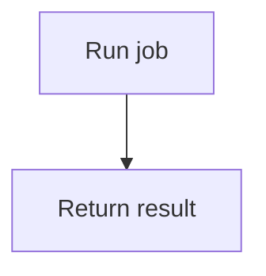

# Checker and enforcement contract

The bundled Python-stdlib checker supplies reusable mechanical checks. It verifies neither semantic correctness nor reviewer authenticity. Project adoption also needs complete source coverage, agent discovery, appropriate review and candidate-specific CI/merge settings.

## Manifest version 1

The default path is `docs/flow-manifest.json`. Paths are repository-relative and must remain inside the repository. Register each source explicitly; source inventory is derived independently from Git and the scope patterns. `snapshot` refreshes registered hashes, without registering unknown files, creating reviews or staging changes.

This is an initial skeleton; run `snapshot` to populate source fingerprints before checking:

```json
{
  "version": 1,
  "scope": {"include": ["src/*"], "exclude": {}},
  "sources": [{"path": "src/jobs.py", "kind": "python"}],
  "features": [{
    "id": "job.run",
    "flow": "docs/flows/job-run.mmd",
    "mappings": [
      {"node": "A", "path": "src/jobs.py", "symbol": "run"},
      {"node": "B", "path": "src/jobs.py", "symbol": "run"}
    ],
    "depends_on": []
  }],
  "reviews": [],
  "policy_inputs": ["AGENTS.md", "tools/flow-docs/flow_checker.py"],
  "limits": {"nodes": 25, "branch_depth": 8}
}
```

`scope.include` uses case-sensitive shell-style `fnmatch` patterns over full relative paths. Choose patterns that account for all first-party behavioral inputs; `src/*` is only an example. `scope.exclude` maps narrow patterns to reviewable reasons. Changes to scope/policy affect review obligations; excluding first-party logic leaves whole-project coverage incomplete.

A `python` source records raw `md5`, normalized module `context_hash` and a `symbols` object mapping qualified names to SHA-256 AST hashes. A `file` source records raw `md5` and uses whole-file impact. Symbol names follow Python definitions, for example `run` and `Worker.run`; use the checker's computed inventory rather than guessing. Node mappings may identify a containing symbol for start/end/decision nodes. File-mode mappings omit `symbol` and use the whole file.

A `tree-sitter` source adds an explicit `language`, with `context_hash` and `symbols` populated by the bundled adapters. For example: `{"path":"src/cart.tsx","kind":"tree-sitter","language":"tsx"}`. Tree-sitter mappings require a real computed `symbol`, like native Python. Display navigation as `path#symbol` when useful; the manifest stores those fields separately.

Every declared node must be mapped, every mapping must reference a real node/input/symbol, and discovered Python functions cannot silently remain uncovered. Shared call dependencies require explicit `depends_on` feature links; the checker does not infer a complete call graph. Use file-level mode when dependencies or dynamic behavior cannot be safely bounded.

To remove a feature, retain its ID and historical flow with `retired: true` and empty `mappings`. Retirement requires a current review. Deleting its record entirely loses historical responsibility and is rejected. Retired flows remain parseable history and do not claim current source-node mappings.

## AST impact and fingerprints

AST normalization ignores comments, source locations and layout; it retains runtime syntax, including docstrings. Refresh raw MD5 after cosmetic edits, but unchanged AST content alone creates no semantic review obligation.

A symbol body change affects its mapped features and declared dependents. Module-context changes, such as imports, globals, definition headers/defaults/decorators or class context, conservatively affect all features mapped to the module. File-level mode affects every feature mapped to that file. New symbols and files still need explicit coverage after a snapshot refresh.

Review fingerprints bind the base identity, scope/policy, affected feature metadata, flow contents, relevant source semantics and dependent-feature contents. Raw file-level inputs remain byte-sensitive. Review output records are excluded from their own fingerprints. Source/flow/mapping/test/checker or policy changes invalidate affected evidence; a timestamp or hash update is insufficient approval.

Use `policy_inputs` for the project-owned checker, agent instructions, validation configuration and behavior tests that should invalidate reviews when changed. Preserve input versions and execution results separately. The content-level evidence may be reused only when all bound inputs match; final required checks still target the actual candidate.

## CLI and staged hook

Python 3.10+ and Git are required. Native Python and file modes use only the standard library. Cross-language AST mode requires the pinned optional packages:

```bash
python3 -m venv .venv-flow-docs
.venv-flow-docs/bin/python -m pip install -r tools/flow-docs/requirements-ast.txt
```

Use that environment's Python to run the checker, including CI/hooks; Windows uses its `Scripts/python.exe`. Install dependencies during setup, not implicitly while analyzing source. Copy the complete skill `scripts/` directory to `tools/flow-docs/`; its sibling adapter and dependency pins are needed for cross-language mode.

Arguments follow the subcommand:

```bash
python3 tools/flow-docs/flow_checker.py snapshot --root .
python3 tools/flow-docs/flow_checker.py fingerprint --root . --base HEAD --feature job.run
python3 tools/flow-docs/flow_checker.py check --root . --base HEAD
python3 tools/flow-docs/flow_checker.py check --root . --base HEAD --staged
```

`fingerprint` prints a SHA-256 hex value. `check` exits `0` on mechanical success and `1` on validation failure, naming the missing action. Missing bases, invalid schema, unsupported inputs and unavailable tools fail visibly. A baseline with no manifest in the existing base treats candidate features as newly adopted; a nonexistent Git base is not silently accepted.

Worktree and staged validation are different snapshots. `--staged` reads the Git index, so unstaged fixes cannot make a bad commit pass. `snapshot --staged` is rejected; snapshot updates the worktree only, and the operator must stage intended results. Do not mix worktree review fingerprints with staged checks.

The [pre-commit template](../assets/pre-commit) expects a project-owned checker at `tools/flow-docs/flow_checker.py`. Copy the complete scripts directory there and adapt the hook to the project's existing hook manager or `core.hooksPath`. Set `FLOW_DOCS_PYTHON` to the parser environment's interpreter when using optional AST dependencies; otherwise the hook uses `python3`. Preserve existing hooks; do not overwrite them or change global Git configuration. A local pre-commit hook can be bypassed, so CI must run the same checker against the actual candidate with a trusted base. Keep protected review for checker, workflow and scope-policy changes.

## Tested language adapters

The optional backend uses the pinned [Tree-sitter language pack 0.13.0 API](https://github.com/Goldziher/tree-sitter-language-pack/blob/v0.13.0/README.md), verified against installed grammars. Grammar availability alone does not establish symbol-adapter coverage. The current fixture scope is:

| `language` | Example computed symbol | Boundary |
| --- | --- | --- |
| `javascript`, `typescript`, `tsx` | `login`, `CartProvider`, `Cart.method` | Named functions, arrow/function-valued variables, class methods; JSX/template literals preserved |
| `go` | `Login`, `*OrderService.Cancel` | Receiver-qualified methods and functions |
| `rust` | `Order::cancel`, `Trait for Order::cancel` | Functions, impl/trait/module scopes |
| `java`, `csharp` | `OrderService.createOrder` | Named methods/constructors; duplicate overloaded names require explicit file fallback |
| `c`, `cpp` | `run`, `app::Order::cancel` | Function declarators and namespace/class scopes |
| `gdscript` | `run`, `Worker.run` | Named functions/class scopes |
| `sql` | `table.orders` | Supported grammar's `CREATE TABLE` blocks; other statements remain conservative context |
| `prisma` | `model.Order` | Model blocks; other constructs remain conservative context |
| `json` | `/database`, `/a~1b` | Root object keys as escaped JSON Pointers; nested values belong to their root key |

Python's built-in AST remains available through `kind: "python"`. Other languages or constructs can always be registered with `kind: "file"`. Selected AST mode fails on a missing parser, unsupported language, parse error, duplicate symbol or no supported symbols; it never silently downgrades. Context-only native Python files also require `kind: "file"`.

Tree-sitter normalizes syntax, not language runtime semantics. Retain explicit cross-feature dependencies for frontend/API/schema relationships, build flags and code generation. Unsupported dynamic behavior, overloads and uncertain dependencies require conservative file mode or a tested project-specific adapter. Updating parser/adaptor versions is a policy change needing revalidation.

[Git's function-range history](https://git-scm.com/docs/git-log) can assist investigation. Regex hunk context cannot replace syntax-aware hashes, complete symbol inventory or dependency analysis; it is not an automatic semantic backend here.

## Headless diagram validation

The portable parser intentionally accepts a small diagram subset. It fails unsupported constructs rather than treating a partial parse as validation. Use the project's native parser when adopting richer syntax.

Mermaid supports a `flowchart TD` or `flowchart LR` header, one explicitly named node per line, `A["label"]`/`A{"label"}` definitions, and `A --> B`/`A -->|condition| B` edges. Comments use `%%`. For example:



PlantUML supports an `@startuml`/`@enduml` named-state graph, `state "label" as A` definitions and `A --> B : condition` edges. This is not a full PlantUML activity/state grammar. Keep labels and node IDs within the parser's accepted syntax; malformed or unsupported input fails.

The default limits are 25 nodes and branch depth 8, configurable through `limits`; supported node budgets are 1 through 1000. Branch depth is the longest weighted path through strongly connected components, counting branching components. Collapsing loops makes this metric finite; it is a complexity proxy, not a proof of readability. Render and inspect when tooling exists. In headless environments, report structural/complexity results and `visual verification: pending` separately.

Committed thumbnails/overview images must still be regenerated with the project's toolchain. The portable checker cannot prove arbitrary derived images match a diagram. Use project-specific reproducibility checks in CI, or report derived-view validation incomplete.

## Agent review records

Dispatch [the independent reviewer prompt](reviewer-prompt.md) automatically when a fresh-subagent facility is available. Provide raw source/dependencies in addition to diff and flows; those alone may omit critical context. Retain required human approvals where repository policy specifies them.

Save the reviewer response as a JSON evidence file. Each manifest review entry contains `feature`, `fingerprint`, `reviewer`, `verdict: "pass"` and `evidence` pointing to that file. The file must identify the same feature, fingerprint, reviewer and passing verdict, with an empty `findings` list. A failed/incomplete response or stale fingerprint is rejected.

These fields form a structured declaration, not an authenticated or cryptographic signature. A malicious author can fabricate JSON. Where authenticity matters, the repository's protected review/check integration must establish it independently. If subagents are unavailable, report independent review incomplete and continue unrelated safe work. Never replace a required result with an author's self-approval.

## Required adoption and acceptance

The inline bootstrap in `SKILL.md` is authoritative for pre-edit reading and is available without loading this reference. Adopt it only with real overview/manifest/flow paths. Preserve local-only root instructions; use a tracked policy plus a documented bootstrap for other workspaces. Check the actual agent entrypoints and nested instruction scopes instead of assuming all tools discover `AGENTS.md`.

Run mechanical cases through the real checker in isolated Git repositories. Verify these cases:

- Valid baseline plus fresh review passes; stale hashes, nonexistent paths/symbols and unmapped new files/functions fail.
- Cosmetic Python edits refresh raw MD5 without unrelated semantic-review churn; one changed function does not invalidate an unrelated function's feature.
- Globals/imports and shared/dependent features receive conservative impact; base mappings prevent deleted records from hiding responsibility.
- Rehash-only changes without current review fail when semantics changed; stale, failed or incomplete review artifacts fail.
- Staged content is checked instead of unstaged fixes; missing bases and unsupported syntax do not silently succeed.
- Invalid graph references, excessive nodes/branch depth and unsafe paths fail; loops terminate in finite time.

Run agent-reading cases as isolated agent scenarios and inspect actual read/edit ordering; a read-set declaration alone is insufficient. Test tiny refactors, deletions, missing baselines, new capabilities, delegated work and expanded scope. Preserve project-specific image/production validation requirements when installing or modifying CI; unexecuted requirements remain incomplete.

Report installed skill, root reading rule, source coverage, structural checker, agent review, visual inspection, required CI and remote merge enforcement separately. No individual result proves the entire workflow correct.
