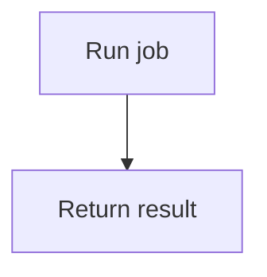

# Checker and enforcement contract

The bundled Python-stdlib checker supplies reusable mechanical checks. It verifies neither semantic correctness nor reviewer authenticity. Project adoption also needs complete source coverage, agent discovery, appropriate review and candidate-specific CI/merge settings.

## Manifest version 1

The default path is `docs/flow-manifest.json`. Paths are repository-relative and must remain inside the repository. Register each source explicitly; source inventory is derived independently from Git and the scope patterns. `snapshot` refreshes registered hashes, without registering unknown files, creating reviews or staging changes.

This is an initial skeleton; run `snapshot` to populate source fingerprints before checking:

```json
{
  "version": 1,
  "scope": {"include": ["src/*"], "exclude": {}},
  "sources": [{"path": "src/jobs.py", "kind": "python"}],
  "features": [{
    "id": "job.run",
    "flow": "docs/flows/job-run.mmd",
    "mappings": [
      {"node": "A", "path": "src/jobs.py", "symbol": "run"},
      {"node": "B", "path": "src/jobs.py", "symbol": "run"}
    ],
    "depends_on": []
  }],
  "reviews": [],
  "policy_inputs": ["AGENTS.md", "tools/flow-docs/flow_checker.py"],
  "limits": {"nodes": 25, "branch_depth": 8}
}
```

`scope.include` uses case-sensitive shell-style `fnmatch` patterns over full relative paths. Choose patterns that account for all first-party behavioral inputs; `src/*` is only an example. `scope.exclude` maps narrow patterns to reviewable reasons. Changes to scope/policy affect review obligations; excluding first-party logic leaves whole-project coverage incomplete.

A `python` source records raw `md5`, normalized module `context_hash` and a `symbols` object mapping qualified names to SHA-256 AST hashes. A `file` source records raw `md5` and uses whole-file impact. Symbol names follow Python definitions, for example `run` and `Worker.run`; use the checker's computed inventory rather than guessing. Node mappings may identify a containing symbol for start/end/decision nodes. File-mode mappings omit `symbol` and use the whole file.

A `tree-sitter` source adds an explicit `language`, with `context_hash` and `symbols` populated by the bundled adapters. For example: `{"path":"src/cart.tsx","kind":"tree-sitter","language":"tsx"}`. Tree-sitter mappings require a real computed `symbol`, like native Python. Display navigation as `path#symbol` when useful; the manifest stores those fields separately.

Every declared node must be mapped, every mapping must reference a real node/input/symbol, and discovered Python functions cannot silently remain uncovered. Shared call dependencies require explicit `depends_on` feature links; the checker does not infer a complete call graph. Use file-level mode when dependencies or dynamic behavior cannot be safely bounded.

To remove a feature, retain its ID and historical flow with `retired: true` and empty `mappings`. Retirement requires a current review. Deleting its record entirely loses historical responsibility and is rejected. Retired flows remain parseable history and do not claim current source-node mappings.

## AST impact and fingerprints

AST normalization ignores comments, source locations and layout; it retains runtime syntax, including docstrings. Refresh raw MD5 after cosmetic edits, but unchanged AST content alone creates no semantic review obligation.

A symbol body change affects its mapped features and declared dependents. Module-context changes, such as imports, globals, definition headers/defaults/decorators or class context, conservatively affect all features mapped to the module. File-level mode affects every feature mapped to that file. New symbols and files still need explicit coverage after a snapshot refresh.

Review fingerprints bind the base identity, scope/policy, affected feature metadata, flow contents, relevant source semantics and dependent-feature contents. Raw file-level inputs remain byte-sensitive. Review output records are excluded from their own fingerprints. Source/flow/mapping/test/checker or policy changes invalidate affected evidence; a timestamp or hash update is insufficient approval.

Use `policy_inputs` for the project-owned checker, agent instructions, validation configuration and behavior tests that should invalidate reviews when changed. Preserve input versions and execution results separately. The content-level evidence may be reused only when all bound inputs match; final required checks still target the actual candidate.

## Change filtering and review cost

The [colored workflow](../SKILL.md#change-filtering-and-synchronization-gate) distinguishes local mechanical checks from agent review. Source MD5 tracks file-byte integrity; normalized syntax hashes filter supported cosmetic edits before feature fingerprints determine review obligations. The checker does not use diff size or ask an agent to classify every changed line.

| Change | Mechanical impact | Flow and review obligation |
| --- | --- | --- |
| Ordinary source comments/formatting in an AST mode, with normalized syntax and other bound inputs unchanged | Raw MD5 becomes stale; refresh with `snapshot` | Keep flows; no new semantic review. Candidate checks still run. |
| Symbol body, branch, operator or literal | Changed symbol hash affects mapped features and declared dependents | Review affected features; edit only flows/contracts whose documented behavior changes. A reviewer must evidence an unchanged-flow decision. |
| Imports, globals, defaults, decorators or other module context | Context hash affects every feature mapped to that file and their declared dependents | Inspect the broader affected scope with full context. |
| File-mode input, including its comments/whitespace | Byte-sensitive file hash affects every mapped feature and declared dependents | Conservative review applies; file mode has no cosmetic filter. |
| Flow bytes, mappings, dependency links or scope/policy | Bound content changes affected fingerprints; flow bytes are not AST-normalized | Review affected synchronization obligations even when source logic is unchanged. Policy changes can affect all features. |
| New source/symbol or missing mapping | Inventory/mapping validation fails independently of `snapshot` | Register and map inputs before passing; no hash refresh can hide missing coverage. |

Python docstrings remain AST content. Whitespace inside literals and recognized Tree-sitter directive comments can affect behavior or tooling, so they are retained. Conversely, syntactically different but behaviorally equivalent code can still trigger review; syntax hashing does not decide runtime equivalence. Remote API changes with unchanged local inputs need separate runtime evidence.

The cost reduction is fewer unrelated flow rewrites and semantic-review calls. Reviewers still need complete relevant base/candidate sources, module context, dependencies, flows and test evidence; they may request more context. `depends_on` must account for cross-feature impact. Whole-file mode cannot recover an omitted cross-file dependency; inventory it and extend mappings/dependency links or the adopted scope.

Fingerprints bind the exact comparison base and relevant content, so changed inputs invalidate affected evidence. No affected features means no new review obligation; it does not reauthenticate previous reviews. Initial adoption against an existing base without a manifest requires review of all candidate features. An invalid base fails; comparing a committed candidate with itself via `--base HEAD` creates an empty comparison and cannot establish change review. CI must select the intended base/candidate and enforce its result through required checks and protected merge settings.

## CLI and staged hook

Python 3.10+ and Git are required. Native Python and file modes use only the standard library. Cross-language AST mode requires the pinned optional packages:

```bash
python3 -m venv .venv-flow-docs
.venv-flow-docs/bin/python -m pip install -r tools/flow-docs/requirements-ast.txt
```

Use that environment's Python to run the checker, including CI/hooks; Windows uses its `Scripts/python.exe`. Install dependencies during setup, not implicitly while analyzing source. Copy the complete skill `scripts/` directory to `tools/flow-docs/`; its sibling adapter and dependency pins are needed for cross-language mode.

Arguments follow the subcommand:

```bash
python3 tools/flow-docs/flow_checker.py snapshot --root .
python3 tools/flow-docs/flow_checker.py fingerprint --root . --base HEAD --feature job.run
python3 tools/flow-docs/flow_checker.py check --root . --base HEAD
python3 tools/flow-docs/flow_checker.py check --root . --base HEAD --staged
```

`fingerprint` prints a SHA-256 hex value. `check` exits `0` on mechanical success and `1` on validation failure, naming the missing action. Missing bases, invalid schema, unsupported inputs and unavailable tools fail visibly. A baseline with no manifest in the existing base treats candidate features as newly adopted; a nonexistent Git base is not silently accepted.

Worktree and staged validation are different snapshots. `--staged` reads the Git index, so unstaged fixes cannot make a bad commit pass. `snapshot --staged` is rejected; snapshot updates the worktree only, and the operator must stage intended results. Do not mix worktree review fingerprints with staged checks.

The [pre-commit template](../assets/pre-commit) expects a project-owned checker at `tools/flow-docs/flow_checker.py`. Copy the complete scripts directory there and adapt the hook to the project's existing hook manager or `core.hooksPath`. Set `FLOW_DOCS_PYTHON` to the parser environment's interpreter when using optional AST dependencies; otherwise the hook uses `python3`. Preserve existing hooks; do not overwrite them or change global Git configuration. A local pre-commit hook can be bypassed, so CI must run the same checker against the actual candidate with a trusted base. Keep protected review for checker, workflow and scope-policy changes.

## Tested language adapters

The optional backend uses the pinned [Tree-sitter language pack 0.13.0 API](https://github.com/Goldziher/tree-sitter-language-pack/blob/v0.13.0/README.md), verified against installed grammars. Grammar availability alone does not establish symbol-adapter coverage. The current fixture scope is:

| `language` | Example computed symbol | Boundary |
| --- | --- | --- |
| `javascript`, `typescript`, `tsx` | `login`, `CartProvider`, `Cart.method` | Named functions, arrow/function-valued variables, class methods; JSX/template literals preserved |
| `go` | `Login`, `*OrderService.Cancel` | Receiver-qualified methods and functions |
| `rust` | `Order::cancel`, `Trait for Order::cancel` | Functions, impl/trait/module scopes |
| `java`, `csharp` | `OrderService.createOrder` | Named methods/constructors; duplicate overloaded names require explicit file fallback |
| `c`, `cpp` | `run`, `app::Order::cancel` | Function declarators and namespace/class scopes |
| `gdscript` | `run`, `Worker.run` | Named functions/class scopes |
| `sql` | `table.orders` | Supported grammar's `CREATE TABLE` blocks; other statements remain conservative context |
| `prisma` | `model.Order` | Model blocks; other constructs remain conservative context |
| `json` | `/database`, `/a~1b` | Root object keys as escaped JSON Pointers; nested values belong to their root key |

Python's built-in AST remains available through `kind: "python"`. Other languages or constructs can always be registered with `kind: "file"`. Selected AST mode fails on a missing parser, unsupported language, parse error, duplicate symbol or no supported symbols; it never silently downgrades. Context-only native Python files also require `kind: "file"`.

Tree-sitter normalizes syntax, not language runtime semantics. Retain explicit cross-feature dependencies for frontend/API/schema relationships, build flags and code generation. Unsupported dynamic behavior, overloads and uncertain dependencies require conservative file mode or a tested project-specific adapter. Updating parser/adaptor versions is a policy change needing revalidation.

[Git's function-range history](https://git-scm.com/docs/git-log) can assist investigation. Regex hunk context cannot replace syntax-aware hashes, complete symbol inventory or dependency analysis; it is not an automatic semantic backend here.

## Headless diagram validation

The portable parser intentionally accepts a small diagram subset. It fails unsupported constructs rather than treating a partial parse as validation. Use the project's native parser when adopting richer syntax.

Mermaid supports a `flowchart TD` or `flowchart LR` header, one explicitly named node per line, `A["label"]`/`A{"label"}` definitions, and `A --> B`/`A -->|condition| B` edges. Comments use `%%`. For example:



PlantUML supports an `@startuml`/`@enduml` named-state graph, `state "label" as A` definitions and `A --> B : condition` edges. This is not a full PlantUML activity/state grammar. Keep labels and node IDs within the parser's accepted syntax; malformed or unsupported input fails.

The default limits are 25 nodes and branch depth 8, configurable through `limits`; supported node budgets are 1 through 1000. Branch depth is the longest weighted path through strongly connected components, counting branching components. Collapsing loops makes this metric finite; it is a complexity proxy, not a proof of readability. Render and inspect when tooling exists. In headless environments, report structural/complexity results and `visual verification: pending` separately.

Committed thumbnails/overview images must still be regenerated with the project's toolchain. The portable checker cannot prove arbitrary derived images match a diagram. Use project-specific reproducibility checks in CI, or report derived-view validation incomplete.

For interactions that benefit from `sequenceDiagram`, subgraphs or richer notation, retain the supported flowchart as the manifest's checked `flow`. Link supplementary diagrams from the feature's existing documentation and review them together. They are outside portable syntax validation. Include a supplementary source in `policy_inputs` when its changes must invalidate reviews; this is global policy and can invalidate all features. A project-specific validator needs its own tested integration; the bundled checker has no plug-in diagram-parser interface.

## Agent review records

Dispatch [the independent reviewer prompt](reviewer-prompt.md) automatically when a fresh-subagent facility is available. Provide raw source/dependencies in addition to diff and flows; those alone may omit critical context. Retain required human approvals where repository policy specifies them.

Save the reviewer response as a JSON evidence file. Each manifest review entry contains `feature`, `fingerprint`, `reviewer`, `verdict: "pass"` and `evidence` pointing to that file. The file must identify the same feature, fingerprint, reviewer and passing verdict, with an empty `findings` list. A failed/incomplete response or stale fingerprint is rejected.

These fields form a structured declaration, not an authenticated or cryptographic signature. A malicious author can fabricate JSON. Where authenticity matters, the repository's protected review/check integration must establish it independently. If subagents are unavailable, report independent review incomplete and continue unrelated safe work. Never replace a required result with an author's self-approval.

## Agent entrypoint discovery

Keep the shared synchronization rule in root `AGENTS.md`; compatibility entrypoints import it. Preserve unrelated and local-only instructions. Before installing a pointer, check the actual working directory, ancestor and nested instruction scopes, effective settings and tool version.

| Observed situation | Action | Acceptance evidence |
| --- | --- | --- |
| Claude Code directly loads the intended `AGENTS.md` | Do not create `CLAUDE.md` | Confirm the file and gate in the actual session's loaded instructions. |
| Root `CLAUDE.md` exists and does not import the rule | Preserve its content; add `@AGENTS.md` outside a code block | Confirm the import resolves and the gate loads. |
| `.claude/CLAUDE.md` is the existing entrypoint | Preserve it; use `@../AGENTS.md` | Confirm resolution relative to that file, not the shell's working directory. |
| `CLAUDE.local.md` or an ancestor instruction file changes discovery | Preserve it; verify a working import or effective simultaneous-loading setting | Check the actual session again; do not blindly modify ancestor files or global settings. |
| Direct support is unavailable or discovery remains unconfirmed | Use a minimal `CLAUDE.md` import fallback when needed, retaining one shared rule | Until the actual session is observed, report discovery unverified. |
| Another tool or a nested instruction scope is used | Verify its own discovery/import mechanism and effective rule | Do not assume root `AGENTS.md` is automatically loaded everywhere. |

The [Claude Code memory documentation](https://code.claude.com/docs/en/memory#agents-md), checked 2026-10-23, documents direct support from v2.1.277 with session exceptions. By default, a `CLAUDE.md`, `.claude/CLAUDE.md` or `CLAUDE.local.md` in the working directory or an ancestor selects Claude instructions instead. User `~/.claude/CLAUDE.md` and managed instructions do not cause that switch. Preserve local preferences and explain this risk rather than forbidding `CLAUDE.local.md`.

Exceptions include disabled built-in support and some first sessions after upgrading from v2.1.276 or earlier; before v2.1.281, some Bedrock/telemetry-disabled sessions also lack direct support. The `instructionFiles` value `claude-md-and-agents-md` can load both instruction types. Its file-based configuration is accepted from user, `--settings` or managed settings, not project/local settings. Recheck current documentation and the effective session before changing settings.

Use `/memory` or `/context` to inspect loaded files on supporting versions; directly loaded `AGENTS.md` is not listed before v2.1.280. Direct loading does not fire `InstructionsLoaded`, so that hook's absence is not proof of a missing rule. Instruction loading establishes availability; observing required document reads before the first dependent edit is a separate acceptance case. Neither establishes comprehension. This package has no pre-edit blocking hook.

## Adoption inventory and staged rollout

Record actual document paths and owners in the project's existing index. Requirements and contracts own expected behavior, architecture documents own responsibilities, and feature flows own branches/interactions and source navigation. Source inspection supplies evidence of implemented behavior. Resolve a conflict with the relevant owner; do not automatically rewrite an intended contract to match a defect or copy competing authoritative descriptions.

Inventory a core end-to-end feature with the following dependency checklist before narrowing the initial scope:

- Public entrypoints, HTTP routes, factories, callbacks, plugins and dynamic dispatch.
- Frontend/API/schema relationships, shared services, subprocesses and cross-language boundaries.
- Imports/globals, configuration, templates/static inputs, build flags and generated-code inputs that affect behavior.
- External APIs, remote configuration and floating dependencies requiring runtime evidence.

Use existing source-discovery or call-graph tools to find candidates, then verify them against source. Record the consuming feature's explicit `depends_on` links to shared features. When a relationship is uncertain, inspect and extend mappings/dependency links or the scope; file mode alone cannot discover cross-file dependencies.

For a mixed-language project, choose modes explicitly before running `snapshot`:

| Source example | Initial source record | Boundary |
| --- | --- | --- |
| `src/download.py` | `{"path":"src/download.py","kind":"python"}` | Built-in AST; map all discovered symbols. |
| `src/client.cjs` | `{"path":"src/client.cjs","kind":"tree-sitter","language":"javascript"}` | Optional pinned parser; the same adapter supports `.js` inputs. |
| `native/download.rs` | `{"path":"native/download.rs","kind":"tree-sitter","language":"rust"}` | Optional pinned parser with qualified symbols. |
| `web/download.html`, CSS, Dockerfile or YAML | One explicit `{"path":"web/download.html","kind":"file"}` record per real path | Byte-sensitive fallback; these formats have no bundled symbol adapter. |

These are source-record fragments, not a complete manifest. Missing parsers do not silently downgrade: explicitly choose file mode if appropriate. Use the computed symbol inventory, map each checked flow node, and include tests/checker/parser/instruction policy inputs as required by the [manifest contract](#manifest-version-1).

For example, first adopt `download.run` together with its `network.fetch` dependency, UI/native entrypoints and required configuration, even when they live in different directories. Map their sources and flows, run `snapshot`, obtain initial reviews and check against a real existing base. List unrelated features outside `scope.include` and unresolved areas as coverage gaps; only the adopted scope can be called covered. Expand through another reviewed scope/mapping change. Excluding an unknown dependency from an already adopted feature cannot turn incomplete coverage into a pass claim.

## Runtime evidence template

Save this Markdown record through the project's existing evidence process and provide its path to the reviewer. It is separate from the required reviewer JSON and does not create approval. Fill it from an executed scenario; otherwise mark the scenario unverified.

```markdown
### Runtime evidence: <feature / scenario>
- Base: <full comparison commit>
- Candidate: <commit, or worktree/staged identity plus relevant input hashes>
- Environment: <application/runtime versions and configuration identity>
- External dependency: <service/API and version, or observation timestamp>
- Preflight: <environment/service readiness checks and observed results>
- Operation and inputs: <reproducible steps / fixture identity>
- Expected behavior: <owning requirement or contract reference>
- Actual behavior: <observed result, including errors/recovery when relevant>
- Side effects and cleanup: <state changes, cleanup result and residual state>
- Evidence: <test command/result, logs, trace or screenshot paths>
- Evidence retention: <artifact locations that survive temporary-environment cleanup>
- Failure classification: <documentation mismatch, verification gap, behavior regression, none or unverified; supporting evidence>
- Limitations: <not-run branches, unavailable services or unknown versions>
```

Classify failures from evidence: a stale description, insufficient verification, or implemented behavior violating its requirement. A verification gap leaves behavior unverified; it does not justify weakening the contract or declaring a product regression. Preserve logs/artifacts outside disposable environments before cleanup.

## Completion report

Use separate statuses such as `passed`, `failed`, `incomplete`, `not run` or `unverified`, with evidence for the exact scope and candidate. The following is a report template, not a list of completed checks:

| Gate | Required report content |
| --- | --- |
| Installation | Installed skill/tool paths and resource completeness. |
| Root rule and discovery | Rule location, actual entrypoints and session loading evidence. |
| Read-before-edit | Observed document identities and read/edit ordering; unverified without a trace. Recheck after scope expansion, delegation or resume. |
| Coverage | Adopted features/inputs, dependency inventory, exclusions and unknowns; partial or whole-project claim. |
| Structural checker | Exact base/candidate, worktree or staged mode, command and result; no semantic-correctness claim. |
| Agent semantic review | Feature fingerprints, reviewer/evidence paths and findings; structured records do not authenticate a reviewer. |
| Behavior and external inputs | Test/runtime evidence, external versions or observation time, and skipped cases. |
| Visual inspection | Rendered diagrams/derived views inspected, or visual verification pending. |
| CI, human and merge requirements | Actual required check/candidate, protected review settings and required human approvals; unverified remote controls remain unverified. |

## Integration follow-ups

The following capabilities are not bundled. The current adoption workflow remains usable within its declared coverage and verification boundaries.

| Capability | Disposition and reason | Before implementation |
| --- | --- | --- |
| Pre-edit blocking hook | Evaluate separately; can reduce missed reads but cannot prove understanding. Blocking only Edit/Write leaves shell and other write paths. | Define session/worktree isolation, document versions, read-set invalidation on scope/delegation/resume, and tool coverage/bypasses. |
| Automatic dependency inventory | Checklist provided; automation remains an aid, not complete-call-graph proof. | Bound supported dispatch/language patterns and require source verification for uncertain relationships. |
| Sequence/subgraph parser | Supplementary-diagram alternative provided; native parsing deferred. | Define message/node-to-source mappings, branches/loops, complexity metrics and failing syntax cases. |
| CI workflow template | Separate follow-up; a local `--base HEAD` command is insufficient for a committed CI candidate. | Define trusted comparison base, head/merge candidate and evidence consistency; test base updates, forks, initial adoption and workflow/checker/policy changes. Use minimal permissions and no privileged execution of untrusted code. Verify required checks/protected merge settings separately. |

## Required adoption and acceptance

The inline bootstrap in `SKILL.md` is authoritative for pre-edit reading and is available without loading this reference. Adopt it only with real overview/manifest/flow paths. Preserve local-only root instructions; use a tracked policy plus a documented bootstrap for other workspaces. Check the actual agent entrypoints and nested instruction scopes instead of assuming all tools discover `AGENTS.md`.

Run mechanical cases through the real checker in isolated Git repositories. Verify these cases:

- Valid baseline plus fresh review passes; stale hashes, nonexistent paths/symbols and unmapped new files/functions fail.
- Cosmetic Python edits refresh raw MD5 without unrelated semantic-review churn; one changed function does not invalidate an unrelated function's feature.
- Globals/imports and shared/dependent features receive conservative impact; base mappings prevent deleted records from hiding responsibility.
- Rehash-only changes without current review fail when semantics changed; stale, failed or incomplete review artifacts fail.
- Staged content is checked instead of unstaged fixes; missing bases and unsupported syntax do not silently succeed.
- Invalid graph references, excessive nodes/branch depth and unsafe paths fail; loops terminate in finite time.

Run agent-reading cases as isolated agent scenarios and inspect actual read/edit ordering; a read-set declaration alone is insufficient. Test tiny refactors, deletions, missing baselines, new capabilities, delegated work and expanded scope. Preserve project-specific image/production validation requirements when installing or modifying CI; unexecuted requirements remain incomplete.

Report installed skill, root reading rule, source coverage, structural checker, agent review, visual inspection, required CI and remote merge enforcement separately. No individual result proves the entire workflow correct.
